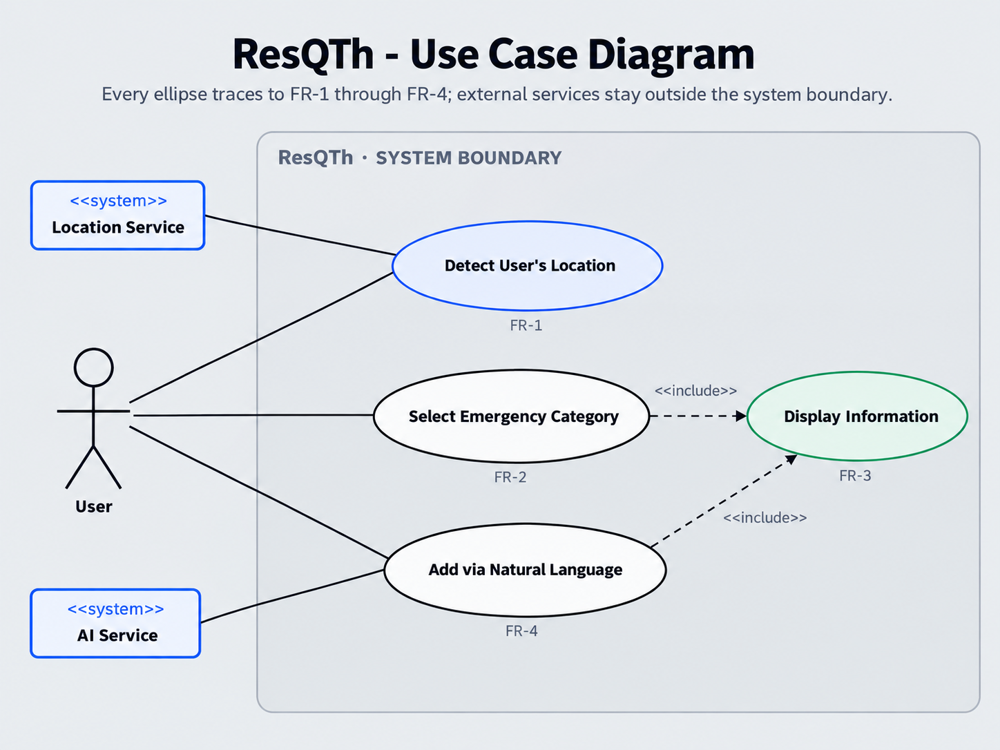
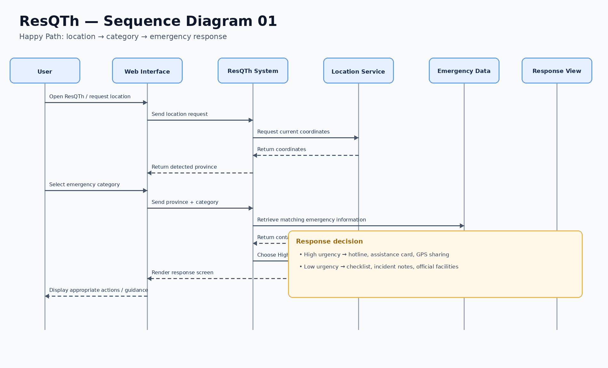
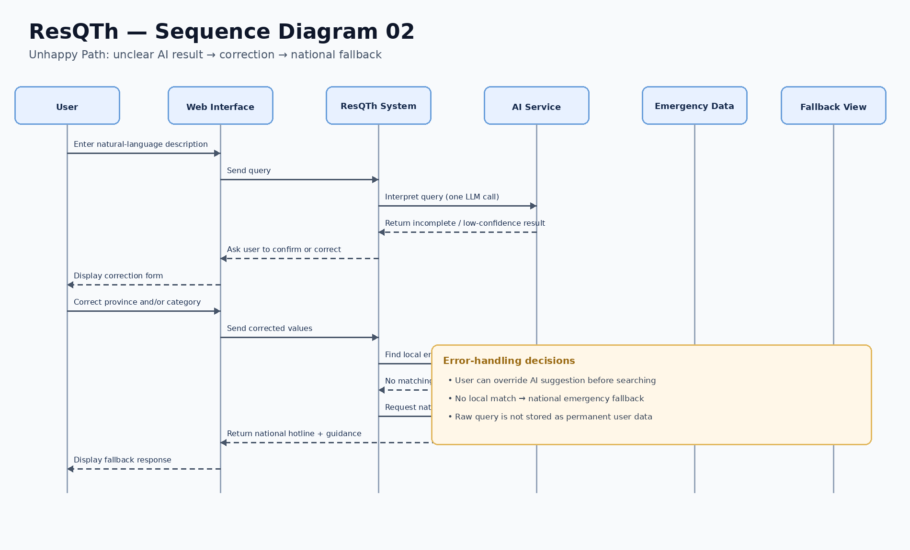

# Design Document: ResQTh

This document describes the UML diagrams, logical data model, and UI design/user-flow mapping for ResQTh. The system architecture is documented separately in the `architecture/` folder.

## Document alignment and implementation status

This design document follows the six functional requirements in the updated M1 Charter and M2 SRS:

- **FR-1:** Detect user's location
- **FR-2:** Select an emergency category
- **FR-3:** Display emergency information and urgency-appropriate actions
- **FR-4:** Natural-language emergency search
- **FR-5:** Share live location with a trusted contact
- **FR-6:** Find nearby emergency facilities

The SRS describes FR-1, FR-2, FR-3, FR-4, and FR-6 as the first-increment/MVP flow and FR-5 as the second increment. The current M3 prototype contains interactive demonstrations for all six areas, but a demonstration is not the same as a production implementation. In particular, the prototype uses mock emergency/facility data, keeps state in browser memory, and does not provide a real backend or database.

**Important implementation distinction:** The current prototype's FR-4 parser is rule-based: it uses English/Thai keywords, aliases, typo tolerance, and a danger-first rule. It does **not** call an LLM. The M1 Charter mentions an LLM API dependency and M2 currently contains a one-LLM-call constraint, so those statements should be reconciled in the SRS before submission. This design document describes the implementation that is actually in the prototype and does not claim that an LLM is connected.

---

## 1. UML Diagrams

### 1.1 Use Case Diagram

The use case diagram should show the six functional requirements listed in the updated SRS. FR-5 should be visually identified as the second-increment feature, while FR-1, FR-2, FR-3, FR-4, and FR-6 form the first-increment/MVP flow.

#### Actors / External Systems

- **User** — the primary actor who uses ResQTh during an emergency or post-incident situation.
- **Browser Geolocation Service** — provides GPS coordinates when the user grants permission. In the prototype, this is accessed through the browser's geolocation API.
- **OpenStreetMap Nominatim** — resolves coordinates to a province during location detection. The prototype sends coordinates to this external service when the user taps **Detect location**.
- **External Map Application** — may be opened for directions from a nearby-facility card. The current facility entries are sample data.
- **Trusted Contact** — the recipient in the FR-5 sharing demonstration. The prototype presents a second phone/contact view, but does not provide a production backend for sharing a real link between independent devices.
- **AI/LLM Service** — **not connected in the current prototype**. The parser is rule-based. Keep this actor in the diagram only if the team explicitly models the intended future LLM-based version and labels it as planned rather than implemented.

#### Use Cases and SRS Alignment

| Use Case | Related FR | Increment / status | Alignment with the SRS and prototype |
| :--- | :--- | :--- | :--- |
| `UC-01 Detect User's Location` | FR-1 | Increment 1; partially implemented | The user can choose a province manually or tap **Detect location**. The prototype uses browser GPS and Nominatim for province lookup; failures leave manual selection available. |
| `UC-02 Select Emergency Category` | FR-2 | Increment 1; implemented as a prototype flow | The user selects or clears a category. The prototype currently provides nine categories, while the M2 SRS examples/list may specify a smaller set; the SRS and test cases should be updated to agree with the prototype's intended category set. |
| `UC-03 Display Emergency Information` | FR-3 | Increment 1; demonstrated with mock data | The prototype routes to a high-urgency or low-urgency interface, with hotline actions, bilingual assistance content, checklist/report guidance, and fallback/sample-data messaging. Phone calling is simulated. |
| `UC-04 Search by Natural Language` | FR-4 | Increment 1; rule-based prototype | The user enters a description in English or Thai. A local keyword parser suggests category, province, and urgency; the user can review and correct the suggestion before continuing. No LLM API is called. |
| `UC-05 Share Live Location with a Trusted Contact` | FR-5 | Increment 2 in the SRS; interactive concept demonstration in the prototype | The prototype demonstrates selecting a contact, choosing a duration, viewing an active/ended state, and stopping/expiring sharing. The displayed two-phone flow is local simulation, not production cross-device sharing. |
| `UC-06 Find Nearby Emergency Facilities` | FR-6 | Increment 1; sample-data demonstration | The user chooses a facility type and sees sample nearby entries/distances. The prototype's distance and route presentation must be treated as demonstrative, not verified live facility search. |

The diagram should not imply that account registration, payment, in-app group chat, medical treatment instructions, or automatic emergency dispatch are supported. The prototype also contains an **“Emergency services, live”** concept screen; it is explicitly a future concept and is not part of the current MVP.

**Diagram maintenance note:** If `diagrams/use-case-diagram.png` still contains only four use cases, update the diagram to include UC-05/FR-5 and UC-06/FR-6. Use the same increment/status distinction shown above.

### 1.2 Sequence Diagram — Manual Emergency Flow (Happy Path)

The happy-path sequence diagram shows the first-increment flow from setting a province to displaying the response.

#### Step-by-step Execution

1. The user opens ResQTh.
2. The user either taps **Detect location** or chooses a province manually.
3. If detection is requested, the browser obtains GPS coordinates after permission is granted and the prototype asks Nominatim to resolve the province.
4. If location detection fails or the user denies permission, the user can still choose a province manually.
5. The user selects an emergency category.
6. The prototype uses the selected province and category to choose the response screen.
7. The appropriate high-urgency or low-urgency interface is displayed using the prototype's current mock data.

#### SRS Alignment and Prototype Limitations

- **FR-1** is represented by GPS-based province detection and manual province selection.
- **FR-2** is represented by selecting or clearing an emergency category.
- **FR-3** is represented by choosing and displaying the urgency-appropriate response.
- The current prototype's hotline/contact and facility data are not yet a verified, province-specific production dataset. The selected province is maintained in the UI, but not every displayed result is genuinely filtered from a separate dataset for that province.
- The call button displays a prototype message rather than initiating a real emergency call from the web app.

### 1.3 Sequence Diagram — Natural-Language Review and Fallback (Unhappy/Recovery Path)

The recovery sequence shows how the user can review a rule-based interpretation and correct it before continuing, and how the prototype can demonstrate a national fallback.

#### Step-by-step Execution

1. The user enters a natural-language description in English or Thai.
2. The prototype runs its local rule-based parser. It does not send the query to an LLM service.
3. The parser suggests a category and may identify a province and urgency.
4. The prototype presents the suggested result for review.
5. The user confirms or changes the category and/or province.
6. The prototype continues using the reviewed values.
7. If the user input is ambiguous or cannot be classified, the prototype offers a review/correction path rather than silently treating the suggestion as certain.
8. The national-fallback screen can be demonstrated, but the current prototype does not perform a real backend lookup that automatically triggers this fallback.

#### SRS Alignment and Prototype Limitations

- **FR-4** requires natural-language input to produce a suggested category, province, and urgency, and lets the user correct the result.
- **FR-3** requires a national emergency fallback when no local contact matches. In the current prototype, the fallback is a demonstrable state rather than a real result of querying a verified, province-specific contact database.
- The M2 SRS currently mentions a one-LLM-call constraint, while the prototype parser is rule-based and makes no LLM call. Reconcile that mismatch in the SRS; do not describe the current parser as an LLM integration.

### 1.4 FR-5 Sequence Coverage — Trusted-Contact Location Sharing

FR-5 is a second-increment requirement in the M2 SRS. The prototype includes an interactive two-phone demonstration, so the design should document it without implying that a real production sharing service exists.

#### Demonstration Flow

1. The user opens the location-sharing sheet.
2. The user chooses a trusted contact and a sharing duration.
3. The user starts sharing in the prototype.
4. The user-facing view displays a simulated active state; the second phone view demonstrates what the trusted contact would see.
5. The user stops sharing, or a configured demonstration timer expires, and the prototype displays an ended/expired state.

#### SRS Alignment and Prototype Limitations

- **FR-5** defines the intended trusted-contact sharing behavior, including a selected recipient, duration, active status, and ending/expiration.
- In the prototype, the two views share in-memory application state. This is not a real link delivered to another device and does not establish a production backend, authentication, access control, or remote location-update service.
- The prototype offers an **“Until I stop”** duration. Because this option does not expire automatically, confirm whether the SRS permits it or change the prototype/SRS so the duration behavior agrees.
- The “Emergency services, live” option is explicitly a future concept and must not be presented as automatic dispatch or as a working MVP capability.

### 1.5 FR-6 Sequence Coverage — Find Nearby Facilities

FR-6 is part of the first-increment scope in the M2 SRS and has a nearby-facility screen in the prototype.

#### Demonstration Flow

1. The user opens **Find nearby** and selects a facility type.
2. If location is available, the prototype shows sample facility entries and estimated distances.
3. The user may request more entries or select **Route**.
4. The route action attempts to open an external map destination using the prototype's sample entry.
5. If location or map functionality is unavailable, the UI should provide a clear message and a way to return to the emergency directory or enable location.

#### SRS Alignment and Prototype Limitations

- **FR-6** requires facility-type filtering, facility names and estimated distances, an appropriate unavailable-results state, and an attempt to open directions in an external map service.
- The prototype's nearby entries are sample data. Do not describe them as verified, live, nearest facilities.
- Check that the prototype's error states and route action meet each FR-6 acceptance criterion before claiming full implementation.

---

## 2. Logical Data Model

The data model describes information the intended ResQTh system may need. It is technology-agnostic and does not select a database or framework.

> **Prototype note:** The current M3 prototype has no real database or backend. It uses JavaScript data structures and in-memory application state. The entities below describe the logical target model; they are not a claim that these records are currently persisted.

### 2.1 Entity Summary

| Entity | Purpose | Related FR / requirement | Current prototype status |
| :--- | :--- | :--- | :--- |
| `Province` | Represents the province used to localize emergency information | FR-1 | A fixed list of supported provinces and aliases is present. |
| `EmergencyCategory` | Represents an incident category and its urgency | FR-2, FR-3, FR-4 | Category definitions and urgency are held in JavaScript data. |
| `EmergencyContact` | Represents an emergency service and its contact number | FR-3 | Mock/sample contact data; numbers must be verified before real-world use. |
| `GuidanceStep` | Represents ordered steps for low-urgency situations | FR-3 | Checklist/guidance content is held in the prototype. |
| `OfficialFacility` | Represents a relevant official facility and its location | FR-3, FR-6 | Nearby facility entries are sample data, not a verified live directory. |
| `IncidentNote` | Represents notes entered during a low-urgency flow | FR-3 | Notes remain temporarily in the current screen/state; they are not saved to a persistent database. |
| `TrustedContact` | Represents a person the user chooses to receive a location-sharing link | FR-5 | Sample contact choices in the sharing demonstration. |
| `LocationShareSession` | Represents a user-initiated sharing session, recipient, duration, status, and expiry | FR-5, NFR-5 | Demonstrated using local in-memory state; no production cross-device sharing backend. |
| `ChecklistBookmark` | Represents a checklist the user chooses to save between sessions | M1 persistence goal | Not implemented in the current prototype. |
| `SavedEmergencyContact` | Represents an emergency contact the user chooses to save | M1 persistence goal | Not implemented as persistent storage in the current prototype. |
| `QueryLog` | Represents a recent query record only when the user has consented to saving it | M1 persistence goal; NFR-5 | The prototype does not persist query logs. Any future implementation must define consent and privacy safeguards. |

### 2.2 Entity Specifications

#### Entity: `Province`

| Attribute | Type | Description |
| :--- | :--- | :--- |
| `provinceId` | String | Unique identifier for a province |
| `nameEnglish` | String | Province name in English |
| `nameThai` | String | Province name in Thai |
| `aliases` | List of strings | Alternative English/Thai names or place aliases used for matching |

#### Entity: `EmergencyCategory`

| Attribute | Type | Description |
| :--- | :--- | :--- |
| `categoryId` | String | Unique category identifier |
| `categoryName` | String | Name of the emergency category |
| `urgencyLevel` | Enum/String | `High` or `Low` |
| `keywords` | List of strings | Keywords used by the current rule-based parser |
| `language` | List of strings | Languages supported by the category's labels/keywords |

The current prototype defines nine categories. The category list in M2 should match the set the team intends to deliver and test.

#### Entity: `EmergencyContact`

| Attribute | Type | Description |
| :--- | :--- | :--- |
| `contactId` | String | Unique contact identifier |
| `name` | String | Name of the emergency service |
| `phoneNumber` | String | Hotline or contact number |
| `provinceId` | String / nullable | Province associated with the contact, if locally specific |
| `categoryId` | String | Emergency category associated with the contact |
| `isNationalFallback` | Boolean | Indicates whether the contact is a national fallback |
| `sourceStatus` | Enum/String | Whether the number is verified, pending verification, or sample data |

#### Entity: `GuidanceStep`

| Attribute | Type | Description |
| :--- | :--- | :--- |
| `stepId` | String | Unique step identifier |
| `instruction` | String | Guidance text shown to the user |
| `stepOrder` | Integer | Display order of the step |
| `categoryId` | String | Related emergency category |

#### Entity: `OfficialFacility`

| Attribute | Type | Description |
| :--- | :--- | :--- |
| `facilityId` | String | Unique facility identifier |
| `name` | String | Name of the facility |
| `facilityType` | String | Type of facility, such as hospital or police station |
| `location` | String | Facility location or address |
| `latitude` / `longitude` | Number / nullable | Coordinates, when available from a suitable source |
| `provinceId` | String / nullable | Province where the facility is located |
| `categoryId` | String / nullable | Related emergency category, when applicable |
| `sourceStatus` | Enum/String | Whether the entry is verified or sample data |

#### Entity: `IncidentNote`

| Attribute | Type | Description |
| :--- | :--- | :--- |
| `noteId` | String | Unique note identifier |
| `content` | String | User-entered incident note |
| `createdAt` | Date/Time | Time the note was created |
| `categoryId` | String | Related emergency category |

Incident notes should remain temporary unless the team defines an explicit save feature and appropriate user consent/privacy behavior.

#### Entity: `TrustedContact`

| Attribute | Type | Description |
| :--- | :--- | :--- |
| `trustedContactId` | String | Unique contact identifier |
| `displayName` | String | Name shown to the user |
| `contactMethod` | String | Method used to reach the contact, if implemented |
| `consentStatus` | Enum/String | Consent/authorization state, if required by the chosen sharing design |

The prototype currently uses sample contact choices; it does not manage a real address book or persist trusted contacts.

#### Entity: `LocationShareSession`

| Attribute | Type | Description |
| :--- | :--- | :--- |
| `shareSessionId` | String | Unique sharing-session identifier |
| `trustedContactId` | String | Intended recipient |
| `startedAt` | Date/Time | Time the user starts sharing |
| `expiresAt` | Date/Time / nullable | Expiration time selected by the user; nullable only if the approved design allows sharing until manually stopped |
| `status` | Enum/String | `Active`, `Stopped`, or `Expired` |
| `latestLocation` | Restricted location reference / nullable | Latest location available during the active session; must be protected and unavailable after sharing ends |

The target system must follow NFR-5: ordinary emergency searches must not store GPS coordinates or associate query/location data with personally identifying information. Location sharing is a separate, explicit, user-initiated session and must stop exposing the location when sharing ends or expires.

#### Entity: `ChecklistBookmark`

| Attribute | Type | Description |
| :--- | :--- | :--- |
| `bookmarkId` | String | Unique bookmark identifier |
| `categoryId` | String | Checklist/category being bookmarked |
| `createdAt` | Date/Time | Time the bookmark was created |

#### Entity: `SavedEmergencyContact`

| Attribute | Type | Description |
| :--- | :--- | :--- |
| `savedContactId` | String | Unique saved-contact identifier |
| `contactId` | String | Reference to an emergency contact |
| `createdAt` | Date/Time | Time the user saved the contact |

#### Entity: `QueryLog`

| Attribute | Type | Description |
| :--- | :--- | :--- |
| `queryLogId` | String | Unique log identifier |
| `querySummary` | String / nullable | Minimal query summary, if the user consents to saving it |
| `createdAt` | Date/Time | Time of the query |
| `consentGiven` | Boolean | Whether the user explicitly consented to save the record |

Do not store raw query text or GPS coordinates linked to a person's identity during ordinary emergency searches. The team should define a minimal, consent-based logging policy before implementing persistent query history.

### 2.3 Main Relationships

- One `Province` can be associated with many `EmergencyContacts`.
- One `EmergencyCategory` can be associated with many `EmergencyContacts`.
- One `EmergencyCategory` can have many `GuidanceSteps`.
- One `Province` can have many `OfficialFacilities`.
- One `OfficialFacility` can be relevant to one or more facility types/categories, depending on the final data design.
- One `EmergencyCategory` can be associated with many temporary `IncidentNotes`.
- One `TrustedContact` can be the recipient of multiple `LocationShareSessions` over time.
- One `EmergencyContact` can be referenced by multiple `SavedEmergencyContacts`.
- One `EmergencyCategory` or checklist can be referenced by multiple `ChecklistBookmarks`.
- A `QueryLog` may be created only under the user's explicit consent and the agreed privacy policy.

### 2.4 Data-Model Alignment with the SRS and M1

- **FR-1** uses `Province` to represent the selected or detected province.
- **FR-2** uses `EmergencyCategory` and its urgency level.
- **FR-3** uses `EmergencyContact`, `GuidanceStep`, `OfficialFacility`, and temporary `IncidentNote` data to display the appropriate response.
- **FR-4** produces temporary category/province/urgency suggestions. The current prototype uses a rule-based parser; no permanent `AIQuery` entity or LLM service is required for that implementation.
- **FR-5** is represented by `TrustedContact` and `LocationShareSession`, but the current prototype's sharing flow is a local demonstration.
- **FR-6** uses `OfficialFacility`, including facility type, location, and sample/verification status.
- **M1 persistence goals** mention saved emergency contacts, bookmarked checklists, and recent query logs with consent. Those are target-model entities, not currently implemented persistent features.
- **NFR-5** limits ordinary-search storage of coordinates and personally identifying links. The intended data model must distinguish ordinary emergency search from a user-initiated location-sharing session.

---

## 3. UI Design and User-Flow Mapping

The UI is designed to help users reach relevant emergency information through a clear flow. The prototype is a browser-based demonstration rather than a complete production service.

### 3.1 Design System

#### Colors

| Design Token | Usage |
| :--- | :--- |
| Primary Blue | Main actions, location controls, links, and focus states |
| Emergency Red | High-urgency response and urgent status |
| Guidance Green | Low-urgency and post-incident guidance |
| Neutral Gray | Backgrounds, borders, and secondary information |
| White | Main cards and content surfaces |

Color is not used alone to communicate urgency. Text labels and icons are also displayed.

#### Typography

- Large bold headings provide visual hierarchy.
- Body text uses readable sentence case.
- Labels and helper text are visually separated from primary information.
- Buttons use clear action-oriented labels, such as **Detect location**, **Choose Province**, **Call 1669**, **Find nearby**, and **Stop sharing**.

#### Spacing

The UI uses a consistent spacing scale: **4 / 8 / 16 / 24 / 32 px**.

#### Reusable UI Components

- Top navigation / language control
- Province-selection screen and location status message
- Emergency-category grid
- Natural-language input panel
- Parsed-result review and correction controls
- Urgency status badge
- Hotline/action card
- Thai-English assistance card
- Checklist and incident-note fields
- Nearby-facility card and directions action
- Trusted-contact sharing sheet
- Active/ended sharing state
- Error / fallback alert
- Help and return-navigation controls

### 3.2 Accessibility Considerations

The prototype includes accessibility-oriented choices such as:

- Visible keyboard focus styles
- Interactive controls designed around a touch-friendly target size
- Labelled form fields
- Semantic HTML controls
- Clear error and fallback messages
- Urgency communicated with text/icons as well as color

These are design choices, not a formal accessibility certification. The team should test keyboard navigation, screen-reader labels, contrast, and touch-target dimensions before making a compliance claim.

### 3.3 UI-to-Requirement Mapping

| UI Screen ID | Screen / State | Mapped Requirement | Action / Trigger | Actual Prototype Behavior |
| :--- | :--- | :--- | :--- | :--- |
| `UI-01` | Choose Province / Location | FR-1 | Detect location or select province | Uses browser geolocation and Nominatim for province lookup when detection is tapped; manual selection remains available after errors. |
| `UI-02` | Emergency Category Selection | FR-2 | Select or clear a category | Displays a nine-category grid and supports category selection/clearing. Align the SRS category list with this prototype set. |
| `UI-03` | High-Urgency Response | FR-3 | Call hotline, show Thai-English help card, open sharing options | Displays sample hotline/action content; call is simulated. Location sharing opens the FR-5 demonstration. |
| `UI-04` | Low-Urgency Guidance | FR-3 | Follow checklist, enter notes, prepare a report, view facility guidance | Checklist/report interactions are available. Notes stay in temporary screen/application state and are not persisted. |
| `UI-05` | Natural-Language Input | FR-4 | Submit a free-text incident description | Runs a local English/Thai keyword-based rule parser. No LLM API call occurs. |
| `UI-06` | Parsed Result Review | FR-4 | Confirm or correct category/province | User can review and manually correct suggested values before continuing. |
| `UI-07` | National Fallback / Unmatched State | FR-3 | Demonstrate a national emergency contact fallback | The state can be demonstrated, but no real backend lookup triggers it automatically. |
| `UI-08` | Nearby Facility Finder | FR-6 | Choose a facility type, inspect sample entries, request directions | Shows sample facility entries/distances; do not present them as verified live search results. |
| `UI-09` | Trusted-Contact Sharing Sheet | FR-5 | Select recipient, choose duration, start/stop sharing | Interactive local demonstration with simulated active/ended states; no production cross-device link service. |
| `UI-10` | Trusted Contact View | FR-5 | View the shared-location demonstration | A second in-app phone view uses the same local state; it is not an independent recipient device. |
| `UI-11` | Future Emergency-Services Tracking Concept | Out of scope / future concept | Open the concept demonstration | Explicitly labelled future concept; not automatic dispatch and not a current MVP capability. |

**Offline state:** The current v5 prototype README says the offline-mode control/demo was removed. Therefore, do not describe `UI-08` or any other screen as an implemented offline demonstration. M2 NFR-4 describes a target for cached offline checklists/hotlines, but that behavior is not currently implemented in this prototype.

### 3.4 Main User Flows

#### Manual Emergency Flow — FR-1 to FR-3

**Choose Province → Select Emergency Category → Display High-/Low-Urgency Response**

- The user may detect location or choose a province manually.
- The user chooses a category.
- The prototype displays the corresponding response interface using mock/sample data.

#### Natural-Language Flow — FR-4

**Choose Province → Describe Situation → Rule-Based Parsing → Review Suggested Result → Correct if Needed → Display Response**

- The parser uses English/Thai keywords and rules locally.
- The result is a suggestion, not a guaranteed correct classification.
- The user can correct the suggested category or province.
- The current prototype does not call an LLM.

#### Nearby-Facility Flow — FR-6

**Open Find Nearby → Choose Facility Type → View Sample Entries/Distances → Request Route**

- Facility names and distances are demonstrative sample data.
- The prototype may attempt to open an external map destination.
- The design must not imply that a verified live facility database or true nearest-place calculation is already implemented.

#### Trusted-Contact Sharing Demonstration — FR-5

**Open Share Location → Choose Contact → Choose Duration → Start Demonstration → View Active State → Stop or Expire**

- The current implementation demonstrates states locally in the prototype.
- It does not provide a production sharing link that works between separate devices.
- The “Emergency services, live” option is a future concept only.

#### Location-Detection Recovery Flow — FR-1

**Tap Detect Location → Success: Province Selected / Failure: Show Message → Manual Province Selection**

This reflects the prototype behavior: a failed location permission or lookup does not prevent the user from manually selecting a province.

### 3.5 Prototype Scope and Limitations

The M3 prototype demonstrates clickable flows without a real backend or database.

**Implemented or demonstrated in the current prototype:**

- Browser GPS request and external province lookup through Nominatim when the user taps **Detect location**
- Manual province selection as a fallback
- Emergency-category selection and urgency routing
- English/Thai keyword-based natural-language parsing, including review/correction
- High-urgency and low-urgency response screens
- Checklist/report interactions and temporary notes
- Nearby-facility screen with sample entries/distances
- Local two-phone sharing demonstration with active/ended states and duration options

**Simulated, sample-based, or not production-ready:**

- Emergency phone calls
- Verified province-specific emergency-contact lookup
- Live/verified nearby-facility search and accurate nearest-facility calculations
- Production facility routing and guaranteed map-service behavior
- A real trusted-contact sharing service across separate devices
- Backend link creation, authentication, access control, and remote location updates
- Automatic emergency-service tracking or dispatch
- Persistent database storage, saved contacts, bookmarks, and query history
- Offline caching of emergency hotlines/checklists
- A connected LLM or AI API for natural-language interpretation

Additional notes:

- The prototype's selected province is maintained in UI state, but the mock emergency-contact and facility data are not yet fully separated into verified province-specific datasets.
- The prototype currently defines nine emergency categories; the M2 SRS should list the same intended categories or explain the scope difference.
- The Thai-language control is present, but verify the completeness and accuracy of Thai translation before claiming full bilingual support.
- Sample emergency numbers and facility entries must be verified against reliable official sources before any real-world use.
- The sharing duration **“Until I stop”** does not expire automatically. Confirm that this is permitted by the agreed FR-5 design or remove/change the option.
- M2 NFR-4's offline-cache behavior is a target requirement, not a capability implemented in the current prototype.
- Performance NFRs are targets and have not been formally measured with real external services at this prototype stage.

---

## 4. Traceability Summary

| Requirement | Main Operation | Main Data | Main UI | Current Prototype Evidence / Limitation |
| :--- | :--- | :--- | :--- | :--- |
| FR-1 | Detect or manually select province | `Province` | UI-01 | Browser GPS + Nominatim lookup; manual fallback. Not a guarantee that all provinces are supported. |
| FR-2 | Select or clear emergency category and set urgency | `EmergencyCategory` | UI-02 | Nine categories in prototype; reconcile the list with M2. |
| FR-3 | Display urgency-appropriate response, hotline, guidance, and fallback state | `EmergencyContact`, `GuidanceStep`, `IncidentNote`, `OfficialFacility` | UI-03, UI-04, UI-07 | Uses mock/sample data; calling is simulated; fallback is demonstrable rather than triggered by a real backend lookup. |
| FR-4 | Parse natural-language input and allow correction | Temporary category/province/urgency values | UI-05, UI-06 | Local rule-based parser; no LLM API call. M1/M2 AI wording must be reconciled with this fact. |
| FR-5 | Demonstrate user-initiated sharing with a selected trusted contact, duration, and stop/expiry state | `TrustedContact`, `LocationShareSession` | UI-09, UI-10 | Local two-phone simulation only; not production cross-device sharing. Second increment in M2. |
| FR-6 | Filter nearby facilities by type and request directions | `OfficialFacility` | UI-08 | Sample entries/distances; not a verified live facility search. |
| M1 persistence goals | Save contacts, bookmark checklists, and optionally retain recent query records with consent | `SavedEmergencyContact`, `ChecklistBookmark`, `QueryLog` | Not currently implemented | Target model only; no persistent storage in the current prototype. |
| NFR-4 | Display required cached content offline after it has been loaded and cached | Cached hotline/checklist data | No implemented offline screen in current prototype | Requirement target only; the prototype's offline demo/control was removed. |
| NFR-5 | Protect location/query privacy and end access after sharing stops/expires | Restricted location-sharing session; consent-based query log | UI-09, UI-10 | Current demo uses local state; production privacy/security behavior requires a backend and verification. |

---

## 5. Alignment Issues to Resolve Before Submission

1. **LLM versus rule-based parser:** M1 mentions an LLM API dependency and M2 has a one-LLM-call constraint, but the prototype explicitly uses a local rule-based parser and makes no LLM call. Decide whether the current project is rule-based for this increment or whether an LLM integration is genuinely planned/implemented, then update M1/M2 consistently. Do not claim an LLM is used by the prototype.
2. **Four versus six use cases:** M2 lists UC-1 through UC-6 and FR-1 through FR-6, so the use-case diagram and checklist should not say there are only four use cases. Show all six and mark FR-5 as the second increment.
3. **FR-5 scope and claims:** M2 places FR-5 in the second increment, while the prototype has a local interactive demonstration. Describe it as a demonstration, not as a production live-location service. Ensure the “Until I stop” option agrees with the final FR-5 expiration rule.
4. **FR-6 traceability:** Include FR-6 in the use-case diagram, data model, UI mapping, and traceability summary. Label nearby facility entries and distances as sample data.
5. **Category count:** The prototype has nine categories; M2's current category examples/list appear smaller. Choose the intended category set and make the SRS, design document, and tests agree.
6. **Offline behavior:** M2 NFR-4 describes offline caching, but the current prototype's offline-mode demonstration was removed. Mark offline behavior as not implemented until it is actually built and tested.
7. **Persistence and privacy:** M1 mentions saved contacts, bookmarked checklists, and consent-based recent query logs. The current prototype does not persist these. Keep them as target-model features unless they are implemented, and make sure any future storage follows NFR-5.
8. **Diagram files:** Verify that the PNG diagrams themselves match the revised text. Updating this document does not automatically update the images in `diagrams/`.
